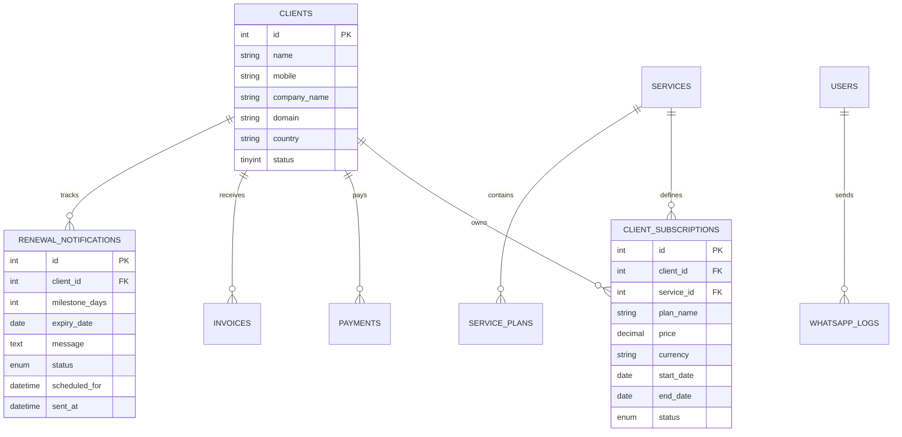
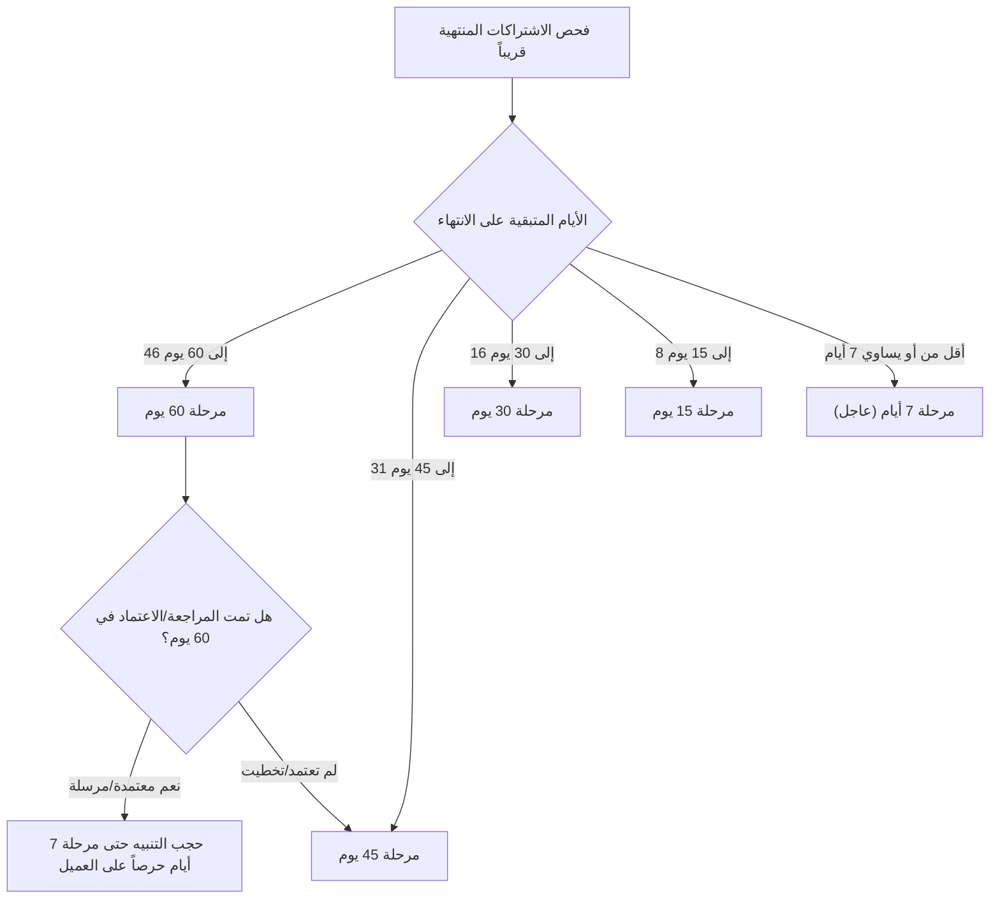

# 🚀 وثيقة المشروع المعمارية ودليل المطور الشامل (Master PRD & Architecture Handbook)
## نظام إنجاز لإدارة العملاء والاشتراكات والتنبيهات الذكية (Enjaz Admin Panel)

> **إصدار التوثيق**: 2.5 (محدث حتى أكتوبر 2026)  
> **حالة النظام**: Live Production على `admin.enjaz.cloud`  
> **البيئة التقنية**: Vanilla PHP 8+, MySQL/MariaDB (PDO), Custom Responsive UI (RTL, Cairo Font), WhatsApp Gateway API, Direct SMTP SSL Sockets.

---

## 📌 فهرس المحتويات
1. [نظرة عامة على النظام وأهدافه](#1-نظرة-عامة-على-النظام-وأهدافه)
2. [المكدس التقني وهيكلية الملفات](#2-المكدس-التقني-وهيكلية-الملفات)
3. [النماذج وقاعدة البيانات والعلاقات](#3-النماذج-وقاعدة-البيانات-والعلاقات)
4. [الوحدات الوظيفية ومنطق الأعمال التفصيلي](#4-الوحدات-الوظيفية-ومنطق-الأعمال-التفصيلي)
   - [إدارة العملاء والاشتراكات وتصدير الإكسيل](#أ-إدارة-العملاء-والاشتراكات-وتصدير-الإكسيل)
   - [محرك تنبيهات التجديد الذكي ومراحله الخمس](#ب-محرك-تنبيهات-التجديد-الذكي-ومراحله-الخمس)
   - [مركز مراجعة واعتماد التجديدات (Renewal Reviews Hub)](#ج-مركز-مراجعة-واعتماد-التجديدات-renewal-reviews-hub)
   - [نظام طابور وجدولة رسائل الواتساب](#د-نظام-طابور-وجدولة-رسائل-الواتساب)
   - [النسخ الاحتياطي اليومي لبيانات العملاء عبر البريد](#هـ-النسخ-الاحتياطي-اليومي-لبيانات-العملاء-عبر-البريد)
   - [النظام المالي، الفواتير، والمدفوعات](#و-النظام-المالي-الفواتير-والمدفوعات)
5. [⚠️ القواعد الذهبية: خطوط حمراء ممنوع المساس بها](#5-⚠️-القواعد-الذهبية-خطوط-حمراء-ممنوع-المساس-بها)
6. [مهام الجدولة التلقائية (Cron Jobs Configuration)](#6-مهام-الجدولة-التلقائية-cron-jobs-configuration)
7. [خارطة الطريق ومسارات التطوير المستقبلي الآمنة](#7-خارطة-الطريق-ومسارات-التطوير-المستقبلي-الآمنة)

---

## 1. نظرة عامة على النظام وأهدافه

نظام **إنجاز للحلول الذكية (Enjaz Admin)** هو منصة إدارة عمليات متكاملة (ERP / CRM مصغر) مصممة خصيصاً لإدارة شركات تكنولوجيا المعلومات والاستضافة والحلول الرقمية.

### الأهداف الأساسية للنظام:
1. **أتمتة دورة حياة اشتراكات العملاء**: متابعة تواريخ التجديد للخدمات (استضافة، دومين، باقات صيانة، تسويق، سيرفرات) وتنبيه العملاء استباقياً قبل التوقف.
2. **صياغة ذكية ومخصصة لرسائل التجديد**: إنشاء رسائل واتساب احترافية تحسب تلقائياً إجمالي المستحقات، توضح تفاصيل الخدمات، تراعي عملة كل عميل (جنيه مصري / ريال سعودي)، وتتحقق من وجود حجز الدومين من عدمه.
3. **مركز مراجعة بشري واعتماد قبل الإرسال**: عدم إرسال أي رسالة عشوائياً للعميل دون مراجعة المسؤول واعتمادها، مع إمكانية التعديل، الجدولة الفردية أو الجماعية، والإرسال الفوري.
4. **تأمين البيانات بنسخ احتياطي يومي تلقائي**: تصدير شيت إكسيل شامل لجميع بيانات العملاء واشتراكاتهم وإرساله مشفراً لبريد الإدارة يومياً الساعة 12:00 منتصف الليل.
5. **الرقابة المالية والمديونيات**: متابعة المقبوضات والمصروفات والأرصدة المعلقة بدقة.

---

## 2. المكدس التقني وهيكلية الملفات

### التقنيات المستخدمة:
- **Backend**: Vanilla PHP 8+ بدون أطر عمل خارجية ضخمة لضمان السرعة الفائقة وانعدام استهلاك الذاكرة.
- **Database**: MySQL 5.7+ / MariaDB 10.3+ عبر اتصال **PDO** الصارم والآمن ضد ثغرات الحقن (`PDO::ATTR_EMULATE_PREPARES => false`).
- **Frontend**: Custom Responsive HTML5/CSS3 يدعم **RTL** كاملاً، خط **Cairo**، أيقونات **FontAwesome 6**، وتفاعلات JavaScript نقية.
- **Mail Engine**: اتصال مباشر بمقابس SMTP المشفرة (`ssl://mail.enjaz.app:465`) مع دعم التشفير الآمن **Base64** المتوافق مع RFC 2821/2822.
- **WhatsApp Integration**: بوابة UltraMsg API الرسمية عبر بروتوكول REST الآمن.

### شجرة المجلدات الرسمية:
```text
enjaz-admin/
│
├── config/                     # إعدادات النظام وقاعدة البيانات
│   ├── .htaccess               # حظر الوصول المباشر
│   ├── app.php                 # الإعدادات العامة، الصلاحيات، والهجرة التلقائية
│   └── db.php                  # اتصال PDO بقاعدة البيانات
│
├── database/                   # نسخ قواعد البيانات وسجلات التحديث
│   ├── .htaccess               # حظر تحميل ملفات SQL
│   ├── enjaz_admin-Live-Database.sql # أحدث هيكل لقاعدة البيانات الحية
│   └── update_renewal_automation.sql # جداول وتحديثات الأتمتة الذكية
│
├── docs/                       # التوثيق والمراجع التقنية
│   ├── README.md               # فهرس الوثائق
│   ├── design_guide.md         # دليل الهوية البصرية والتصميم
│   ├── domains.md              # أسعار وسياسات حجز وتجديد النطاقات
│   ├── enjaz_admin_architecture.md # التوثيق المعماري العام
│   └── whatsapp_api_docs.md    # توثيق WhatsApp API
│
├── includes/                   # المحرك البرمجي المشترك
│   ├── .htaccess               # حظر الاستدعاء الخارجي
│   ├── auth.php                # إدارة الجلسات والمصادقة والصلاحيات
│   ├── client_backup.php       # محرك النسخ الاحتياطي وتوليد CSV وإرسال البريد
│   ├── footer.php              # تذييل الصفحات وملفات JS المشتركة
│   ├── functions.php           # الدوال المساعدة، صياغة الرسائل، ومعالجة SMTP
│   ├── header.php              # الترويسة وشريط التنقل العلوي والقوائم
│   └── renewal_automation.php  # محرك فحص التجديدات وتوليد إشعارات الأدمن
│
├── api/                        # نقاط النهاية السريعة (AJAX Endpoints)
│   ├── check-username.php      # فحص توفر اسم المستخدم
│   ├── service-plans.php       # جلب خطط وأسعار الخدمة المحددة
│   └── whatsapp.php            # إرسال رسائل واتساب مفردة وفورية
│
├── clients/                    # إدارة العملاء (CRUD + تصدير Excel متكامل)
├── services/                   # إدارة الخدمات والخطط والأسعار
├── subscriptions/              # إدارة اشتراكات العملاء وحالاتها
├── payments/                   # تسجيل المقبوضات ورفع الإيصالات
├── invoices/                   # توليد وطباعة فواتير النظام
├── reports/                    # التقارير والتحليلات
│   ├── renewals.php            # تقرير التجديدات القريبة المتقدم
│   ├── renewal_reviews.php     # 🌟 مركز مراجعة واعتماد رسائل التجديد
│   ├── monthly.php             # التقارير الشهرية والسنوية
│   └── financial-hub.php       # المركز المالي ومتابعة المديونيات
│
├── whatsapp/                   # محرك رسائل الواتساب
│   ├── bulk.php                # إرسال جماعي مخصص
│   ├── cron.php                # 🌟 مشغل الكرون اليومي وطابور الانتظار
│   ├── renewal_cron.php        # كرون مخصص لفحص التجديدات وإرسال تنبيه الأدمن
│   ├── schedules.php           # إدارة الرسائل المجدولة وطابور الإرسال
│   └── preview.php             # واجهة معاينة الرسائل المصاغة عبر AJAX
│
├── dashboard.php               # لوحة الإحصائيات العامة
├── settings.php                # صفحة إعدادات النظام واختبارات الإرسال
├── login.php / logout.php      # تسجيل الدخول والخروج الآمن
└── README.md                   # هذا الدليل المرجعي الشامل
```

---

## 3. النماذج وقاعدة البيانات والعلاقات

تم تصميم قاعدة البيانات لتربط العمليات بدقة:



### الجداول الأساسية ودور كل منها:
1. **`clients`**: بيانات العملاء الأساسية (الاسم، الشركة، الهاتف، النطاق، الدولة، السيرفر، الملاحظات).
2. **`services` & `service_plans`**: الخدمات المعروضة (دومين، استضافة، باقات، إلخ) وخططها وأسعارها بالعملات المختلفة.
3. **`client_subscriptions`**: اشتراكات العملاء الفعلية، تاريخ البداية والنهاية، السعر، والعملة (`EGP` أو `SAR`).
4. **`renewal_notifications`**: سجل حالات مراحل التجديد (60، 45، 30، 15، 7 أيام) والرسائل المصاغة وحالة المراجعة (`pending_review`, `approved`, `sent`, `skipped`).
5. **`whatsapp_queue`**: طابور الانتظار للرسائل الجاهزة للإرسال مع توقيت الإرسال وحدود التأخير العشوائي.
6. **`whatsapp_logs`**: السجل التاريخي الكامل لجميع الرسائل المرسلة مع استجابة السيرفر.
7. **`payments` & `invoices`**: متابعة التحصيلات المالية، طرق الدفع، وربطها بالعملاء.
8. **`settings`**: مخزن إعدادات النظام بنظام المفتاح والقيمة (`key`-`value`).

---

## 4. الوحدات الوظيفية ومنطق الأعمال التفصيلي

### أ. إدارة العملاء والاشتراكات وتصدير الإكسيل
- في شاشة العملاء (`clients/index.php`)، يمكن تحديد عميل أو عدة عملاء أو تصدير الكل إلى ملف Excel (CSV).
- **منطق التصدير**:
  - يتم استخراج **25 عموداً شاملاً** لكل عميل (المعرف، الاسم، الشركة، الهاتف الرئيسي والمطبع، البريد، النطاق، كود الدولة، لوحة السيرفر، ملخص الاشتراكات النشطة مجمعة، تاريخ التجديد القادم، إجمالي قيمة الخدمات، المدفوع، المتبقي، وتاريخ التسجيل).
  - استخدام علامة **UTF-8 BOM (`\xEF\xBB\xBF`)** إجبارياً لكي يفتح برنامج Microsoft Excel الملف فوراً باللغة العربية دون تشويه أو مشاكل في الترميز.

---

### ب. محرك تنبيهات التجديد الذكي ومراحله الخمس
يعمل المحرك وفق 5 محطات زمنية محسوبة استباقياً قبل انتهاء الاشتراك:
- **المراحل المعتمدة**: **60 يوم** ⬅️ **45 يوم** ⬅️ **30 يوم** ⬅️ **15 يوم** ⬅️ **7 أيام**.



#### 🧠 منطق حجب التكرار المزعج:
- إذا قام الأدمن باعتماد أو إرسال رسالة التجديد للعميل في مرحلة الـ **60 يوم**، فالنظام **لن يزعج العميل** في مراحل (45 و 30 و 15 يوم)، بل سينقله مباشرة إلى تنبيه الطوارئ الأخير عند **7 أيام** فقط إذا لم يكن قد سدد بعد.

#### 📝 الصياغة الذكية التلقائية (`buildRenewalWhatsappMessage`):
1. **تحديد العملة**: تفحص عملة الاشتراكات؛ إذا كانت مسجلة بـ `SAR` يتم إخراج الرسالة بالريال السعودي، وإلا بالجنيه المصري.
2. **فحص حجز الدومين**: يتحقق النظام هل العميل لديه اشتراك خدمة "دومين" مسجل في النظام؟
   - إذا **نعم**: يدرج سطر تجديد الدومين مع اسم النطاق الصريح وسعره الثابت (1,350 ج للمصري / 86 ر.س للسعودي).
   - إذا **لا**: يتم **استبعاد بند الدومين تماماً** من الرسالة والإجمالي حتى لا يُطالب العميل بخدمة لم يشترك بها.
3. **دمج الخدمات**: دمج باقات الاستضافة، الصيانة، والإيميلات في بنود مفصلة مع تاريخ الاستحقاق الدقيق.

---

### ج. مركز مراجعة واعتماد التجديدات (Renewal Reviews Hub)
يقع في الرابط: `reports/renewal_reviews.php`.
يحتوي المركز على 3 أقسام تفاعلية:
1. **قسم المراجعة المطلوبة**: يعرض كروت العملاء المستحقين للتنبيه.
   - يمكن للأدمن تعديل نص الرسالة مباشرة من الواجهة.
   - زر **"إرسال الآن"**: يفتح نافذة الإرسال الفوري للواتساب مع العميل.
   - زر **"اعتماد للجدولة"**: ينقل الرسالة المجهزة لطابور الإرسال الصباحي.
   - أزرار **العمليات الجماعية (Bulk Actions)**:
     - **اعتماد وجدولة المحدد/الكل**: يقوم بحفظ النصوص المعدلة ونقل كافة العملاء دفعة واحدة للإرسال الصباحي.
     - **إرسال الآن جماعي**: إرسال فوري لجميع الرسائل المحددة عبر WhatsApp API.
2. **قسم الرسائل المعتمدة للإرسال الصباحي**:
   - يعرض الرسائل المعتمدة والمجدولة للإرسال التلقائي.
   - زر **"عرض الرسالة"**: نافذة منبثقة (Modal) تقرأ نص الرسالة عبر سمة `data-msg` بأمان تام دون أخطاء في الـ Quotes أو السطور المتعددة.
   - زر **"إرسال الكل المعتمد الآن"**: خيار طارئ لإرسال جميع المعتمدين فوراً دون انتظار الصباح.
3. **سجل الرسائل المرسلة**: أرشيف تاريخي كامل لما تم إرساله مسبقاً.

---

### د. نظام طابور وجدولة رسائل الواتساب
- **التنبيه الصباحي للأدمن**: يومياً في تمام الساعة **9:00 صباحاً** (`renewal_alert_hour`)، يقوم الكرون بفحص التجديدات وإرسال رسالة واتساب ملخصة لهاتف الأدمن (`01028855779`) تضم قائمة بالعملاء المرشحين ورابط الدخول المباشر للمراجعة.
- **إرسال رسائل العملاء المعتمدة**: يومياً في تمام الساعة **10:00 صباحاً** (`renewal_send_hour`).
- **فواصل الأمان (Anti-Ban Delays)**: توضع مهلة عشوائية بين كل رسالة والأخرى (من 3 إلى 15 ثانية) لضمان عدم حظر الرقم من WhatsApp.
- **توحيد أرقام الهواتف (`normalizeMobile`)**:
  - تنظيف أي مسافات أو رموز (`+`, `-`, `/`).
  - تحويل الأرقام المصرية التي تبدأ بـ `01` إلى الصيغة الدولية `201...`.
  - تحويل الأرقام السعودية التي تبدأ بـ `05` إلى الصيغة الدولية `9665...`.

---

### هـ. النسخ الاحتياطي اليومي لبيانات العملاء عبر البريد
- **موعد التشغيل**: يومياً في تمام الساعة **12:00 منتصف الليل** (`00:00`) عبر ملف الكرون `whatsapp/cron.php`.
- **المستلم الرسمي**: `rashed1711@gmail.com` (مخزن في إعدادات النظام `backup_email`).
- **المحتوى**:
  - تقرير HTML بتصميم إنجاز يضم إحصائيات حية (إجمالي العملاء، النشطين، إجمالي الخدمات، والمديونيات).
  - ملف مرفق `enjaz_clients_backup_YYYY-MM-DD.csv` يضم جميع بيانات العملاء الـ 25 عموداً.
- **محرك البريد المتطور**:
  - يتم الاتصال عبر مقابس السوكت المشفرة مباشرة (`stream_socket_client('ssl://mail.enjaz.app:465')`).
  - استخدام حساب النظام الرسمي: `noreplay@enjaz.app`.
  - **تشفير Base64 الصارم**: تشفير الـ HTML والملف المرفق بترميز Base64 وتقطيعه إلى أسطر قياسية لا تتجاوز 76 حرفاً (`chunk_split(..., 76, "\r\n")`)، وهو ما يتوافق 100% مع معايير RFC ويمنع خطأ السيرفر الشهير (`lines too long for transport`).

---

### و. النظام المالي، الفواتير، والمدفوعات
- **الترقيم التلقائي**: توليد أرقام الفواتير بالتسلسل `INV-0001` وتخزين العداد في جدول `settings`.
- **الحسابات الديناميكية**:
  - `total_services` = مجموع أسعار الاشتراكات غير الملغاة.
  - `total_paid` = مجموع سندات القبض في جدول `payments`.
  - `remaining` = الفرق بين الخدمات والمدفوع (المديونية).
- شاشات طباعة الفواتير وكشوف حسابات العملاء مصممة لتكون جاهزة للطباعة الورقية أو الحفظ كـ PDF بضغطة زر (`Ctrl + P`).

---

## 5. ⚠️ القواعد الذهبية: خطوط حمراء ممنوع المساس بها

> [!CAUTION]
> الدوال والتعليمات التالية حساسة جداً وعليها تعتمد استمرارية النظام على السيرفر الحي. لا تقم بتعديل منطقها الداخلي دون مراجعة هذه الوثيقة:

1. **دالة `normalizeMobile()` في [includes/functions.php](file:///d:/Programs/Androide/websites/enjaz-admin/includes/functions.php)**:
   - مسؤولة عن معالجة أرقام الهواتف لمصر والسعودية.
   - **الخط الأحمر**: إياك وإزالة شرط `strlen === 11` لمصر أو `strlen === 10` للسعودية، أو التلاعب بإضافة أو حذف كود الدولة الدولي؛ أي خلل هنا سيتسبب في فشل وصول رسائل الواتساب أو إرسالها لأرقام خاطئة.

2. **بروتوكول تشفير البريد في `sendSMTPMailWithAttachment()`**:
   - تم استخدام `chunk_split(base64_encode(...), 76, "\r\n")` لكل من الـ HTML والملف المرفق.
   - **الخط الأحمر**: إياك والعودة لإرسال نص الـ HTML بصيغة `8bit` مباشرة؛ سيرفرات cPanel و Exim ترفض الرسائل التي تحتوي على أسطر تزيد عن 998 بايت وترتد فوراً برسالة `message has lines too long for transport`.

3. **شهادة SSL في مقابس السوكت (`stream_context_create`)**:
   - تم ضبط `verify_peer => false` و `verify_peer_name => false`.
   - **الخط الأحمر**: شهادة سيرفر البريد صادرة باسم `cp.enjaz.cloud` بينما يتم الاتصال عبر `mail.enjaz.app`، وإذا تم تفعيل فحص تطابق الاسم الصارم (Strict Peer Name) سيفشل الاتصال في دالة `stream_socket_client` فوراً.

4. **فحص الدومين في `buildRenewalWhatsappMessage()`**:
   - النظام يتحقق من وجود اشتراك دومين حقيقي مسجل للعميل.
   - **الخط الأحمر**: لا تجعل سطر تجديد الدومين يظهر تلقائياً لجميع العملاء، ولا تقم بتغيير أسعار التجديد الثابتة (1,350 جنيه / 86 ريال) إلا بطلب صريح من الإدارة.

5. **أمان الـ CSRF والجلسات**:
   - كل نموذج POST يجب أن يحتوي على `<?= csrfField() ?>` ومتبوع بـ `if (!verifyCsrf())`.
   - **الخط الأحمر**: لا تلغِ التحقق الأمني عن أي نموذج لتسهيل التطوير السريع؛ النظام محمي ضد هجمات تزوير الطلبات Cross-Site Request Forgery.

6. **عرض نصوص الرسائل في المودال (`renewal_reviews.php`)**:
   - يتم تخزين نص الرسالة في سمة HTML5: `data-msg="<?= htmlspecialchars($app['message'], ENT_QUOTES, 'UTF-8') ?>"` واستدعاؤها عبر `this.getAttribute('data-msg')`.
   - **الخط الأحمر**: إياك واستخدام Template Literals داخل السمة مثل `onclick="viewMessageModal(`${msg}`)"`؛ لأن الرسائل تحتوي على نصوص عربية واقتباسات وأسطر جديدة تكسر محرك JavaScript في المتصفح.

---

## 6. مهام الجدولة التلقائية (Cron Jobs Configuration)

لكي يعمل النظام بكامل طاقته التلقائية على استضافة cPanel / Linux، يجب ضبط أمرين للكرون جوب:

### 1. كرون تشغيل طابور الواتساب والباكب الليلي (الأساسي):
- **المسار**: `whatsapp/cron.php`
- **معدل التكرار**: كل دقيقة أو كل 5 دقائق (`* * * * *` أو `*/5 * * * *`).
- **الأمر في cPanel**:
```bash
/usr/local/bin/php /home/username/public_html/whatsapp/cron.php >/dev/null 2>&1
```
- **ما يفعله هذا الملف**:
  - يرسل الرسائل التي حان وقتها من جدول `whatsapp_queue`.
  - ينفذ جدولات الواتساب العامة المستحقة.
  - يفحص توقيت الساعة 12:00 منتصف الليل؛ وإذا حان وقتها يولد شيت العملاء ويرسله فوراً لبريد الإدارة `rashed1711@gmail.com` مرة واحدة فقط في اليوم.

### 2. كرون أتمتة مراجعة التجديدات (اختياري / إضافي):
- **المسار**: `whatsapp/renewal_cron.php`
- **معدل التكرار**: كل نصف ساعة (`*/30 * * * *`).
- **الأمر في cPanel**:
```bash
/usr/local/bin/php /home/username/public_html/whatsapp/renewal_cron.php >/dev/null 2>&1
```
- **ما يفعله هذا الملف**:
  - يفحص التجديدات ويسجلها في `renewal_notifications`.
  - يرسل تنبيه الأدمن الصباحي على الواتساب الساعة 9:00 ص.
  - يرسل رسائل التجديد المعتمدة للعملاء الساعة 10:00 ص.

---

## 7. خارطة الطريق ومسارات التطوير المستقبلي الآمنة

إذا أردت تطوير النظام في المستقبل، فإليك أفضل الممارسات والمسارات الموصى بها:

### أ. كيفية إضافة شاشة أو موديول جديد بأمان:
1. أنشئ مجلداً جديداً للوحدة (مثلاً `contracts/`).
2. ضع في بدايته كود الحماية الموحد:
   ```php
   require_once dirname(__DIR__) . '/config/app.php';
   requireLogin();
   requirePermission('your_permission_name');
   ```
3. استخدم الدوال الجاهزة في [includes/header.php](file:///d:/Programs/Androide/websites/enjaz-admin/includes/header.php) و [includes/footer.php](file:///d:/Programs/Androide/websites/enjaz-admin/includes/footer.php) للحفاظ على التنسيق الموحد.

### ب. أفكار تطويرية مقترحة (Roadmap):
1. **بوابات الدفع الإلكتروني (Online Payment Gateways)**:
   - إضافة رابط دفع إلكتروني مباشر داخل رسالة الواتساب (عبر فواتك، فودافون كاش، أو Paymob).
   - استقبال Webhook من بوابة الدفع لتحديث حالة الفاتورة والاشتراك إلى "نشط" تلقائياً.
2. **الربط مع مسجلي الدومينات (Domain Registrar APIs)**:
   - ربط استعلام تواريخ انتهاء الدومينات مباشرة مع Namecheap أو GoDaddy أو ResellerClub لتحديث تواريخ انتهاء الدومين تلقائياً.
3. **بوابة العملاء (Client Portal)**:
   - واجهة مخصصة يدخل إليها العميل برقم هاتفه للاطلاع على فواتيره ومواعيد تجديد خدماته وتحميل إيصالاته.
4. **قنوات تنبيه مساندة (Fallback Notifications)**:
   - دعم إرسال رسائل SMS أو رسائل عبر Telegram Bot في حال فشل إرسال رسالة الواتساب لأي سبب.

---

**تمت صياغة هذا الدليل ليكون مرجعك البرمجي والتشغيلي الموثوق دائماً. حافظ على هذا الملف واقرأه قبل إجراء أي تعديلات جوهرية.**

